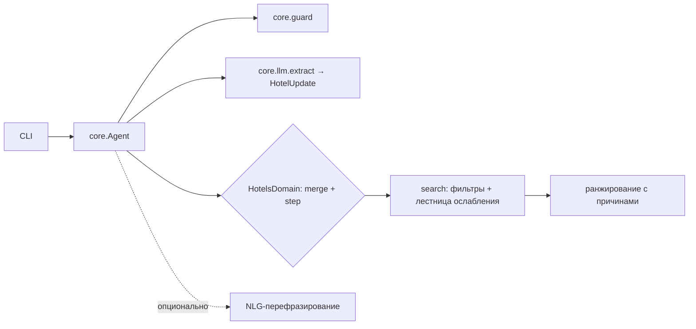

# 02. Архитектура

## Схема



## Модули

| Путь | Назначение |
| :--- | :--- |
| `core/config.py` | Настройки из `.env`: адрес, ключ и модель LLM, флаги |
| `core/llm.py` | OpenAI-совместимый клиент (Cloud.ru, vLLM, Ollama, OpenRouter) и `extract()`: JSON → Pydantic с одной попыткой ремонта и пустой моделью в качестве fallback |
| `core/guard.py` | Очистка ввода, лимит длины, эвристика против промпт-инъекций |
| `core/agent.py` | Контракт `Domain`, `Session`, цикл `Agent.handle()` |
| `core/ru.py` | Форматирование дат, денег и плюралов по-русски |
| `domains/hotels/state.py` | Параметры поиска и то, что LLM извлекает из одной реплики |
| `domains/hotels/catalog.py` | Модель отеля и вымышленный каталог; сюда подключается адаптер к данным Островка |
| `domains/hotels/search.py` | Фильтры, лестница ослабления, скоринг с объяснимыми причинами |
| `domains/hotels/domain.py` | Промпт извлечения, слияние параметров, сборка ответа |
| `apps/cli.py` | Консольный чат |
| `tests/` | Тесты на `FakeLLM`, без сети |

## Контракт домена

```python
class Domain(Protocol):
    name: str
    state_model: type[BaseModel]    # полное состояние диалога
    update_model: type[BaseModel]   # что LLM может извлечь из одной реплики
    off_topic_reply: str
    def extraction_messages(state, history, text, today) -> list[Message]
    def merge(state, update) -> state         # нормализация + слияние, без LLM
    def step(state) -> Step                   # policy: спросить / найти / ответить
```

Реальные данные Островка подключаются адаптером каталога. Ядро при этом не меняется.

## Политика отказоустойчивости

| Сбой | Поведение |
| :--- | :--- |
| LLM недоступна или таймаут | Пустой update; агент повторяет уточняющий вопрос и не падает |
| Невалидный JSON | Одна попытка ремонта с текстом ошибки, затем пустой update |
| Пустой результат поиска | Ослабляем фильтры по лестнице и явно говорим, что именно ослабили |
| Инъекция или офтоп | Вежливый возврат к теме, LLM не вызывается |
| NLG-перефразирование упало | Отдаём детерминированный черновик |
