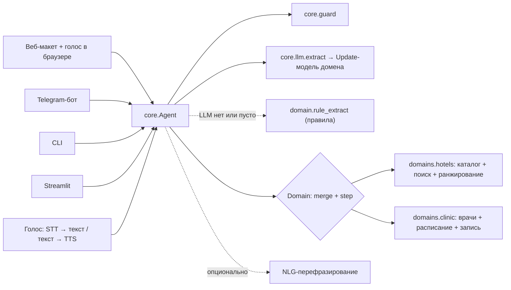

# 02. Архитектура

## Схема



## Модули

| Путь | Назначение |
| :--- | :--- |
| `core/config.py` | Настройки из `.env`: адрес, ключ и модель LLM, флаги |
| `core/llm.py` | OpenAI-совместимый клиент (Cloud.ru, vLLM, Ollama, OpenRouter) и `extract()`: JSON → Pydantic с одной попыткой ремонта и пустой моделью в качестве fallback |
| `core/guard.py` | Очистка ввода, лимит длины, эвристика против промпт-инъекций |
| `core/agent.py` | Контракт `Domain`, `Session`, цикл `Agent.handle()` |
| `core/ru.py` | Форматирование дат, денег и плюралов по-русски |
| `domains/hotels/` | Островок: модель отеля, мок-каталог, поиск с ослаблением фильтров, скоринг с причинами |
| `domains/clinic/` | DBI: врачи, расписание со слотами, запись, поиск альтернатив |
| `domains/clinic/rules.py` | Разбор фраз пациента по правилам: fallback к LLM и работа без ключа |
| `apps/web/` | Веб-макет DBI: FastAPI и страница с голосом (Web Speech API), чатом, панелью регистратуры и отладкой |
| `apps/cli.py` | Консольный чат для ручной проверки |
| `tests/` | Тесты на `FakeLLM`, без сети |

## Контракт домена

```python
class Domain(Protocol):
    name: str
    state_model: type[BaseModel]    # полное состояние диалога
    update_model: type[BaseModel]   # что LLM может извлечь из одной реплики
    off_topic_reply: str
    def extraction_messages(state, history, text, today) -> list[Message]
    def merge(state, update) -> state         # нормализация + слияние, без LLM
    def step(state) -> Step                   # policy: спросить / найти / записать
```

Новый кейс (М.Видео, реальные данные Островка) подключается новым доменом или адаптером каталога. Ядро при этом не меняется.

## Политика отказоустойчивости

| Сбой | Поведение |
| :--- | :--- |
| LLM недоступна или таймаут | Пустой update. Бот повторяет уточняющий вопрос и не падает |
| Невалидный JSON | Одна попытка ремонта с текстом ошибки, затем пустой update |
| Пустой результат поиска | Ослабляем фильтры по лестнице и явно говорим, что именно ослабили |
| Слот заняли между показом и записью | Предлагаем новые варианты |
| Инъекция или офтоп | Вежливый возврат к теме, LLM не вызывается |
| NLG-перефразирование упало | Отдаём детерминированный черновик |

## Голосовой слой (DBI, неделя 13–19 окт)

- STT: `faster-whisper` (large-v3 или turbo) на GPU Cloud.ru, альтернатива — облачный STT. Обязательно меряем WER на медицинской лексике и фамилиях.
- TTS: Silero (локально, быстро, русский язык) или облачный TTS.
- Транспорт для демо: голосовые сообщения в Telegram, это самый надёжный вариант. Звонок через WebRTC или телефонию — только как stretch-цель.
- Ответы домена `clinic` пишутся сразу под TTS: короткие фразы, без markdown, время произносится словами.
