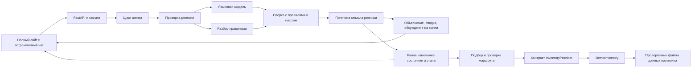

# Архитектура прототипа

Прототип принимает запрос о поездке, сохраняет состояние диалога в памяти приложения и последовательно предлагает направления, варианты поездки, корзину и имитацию оформления. Реальных платежей, бронирований и писем он не выполняет.

## Границы ответственности

- `apps/` — HTTP API, веб-интерфейс и отдельные сессии. Разметка, стили и поведение основного сайта и виджета разделены по файлам. Карта вынесена в отдельный компонент, принимающий данные и обработчик выбора извне. Сессии хранятся в памяти и не переживают перезапуск.
- `core/` — цикл агента, защита от типовых инъекций, клиент модели, проверка ответа и переключение на правила при сбое.
- `domains/trips/` — состояние поездки, извлечение параметров, сверка результата модели, этапы диалога, подбор и объяснение вариантов. Модель извлекает пожелания; цены, даты, расчёт и подтверждение действий выполняет код приложения.
- `dialogue.py` отвечает за недостающие сведения и идеи без цены, `tent.py` — за отдельный сценарий своей палатки, `world_places.py` — за поиск имён в справочнике без обещания наличия предложений.
- `conversation.py` отделяет обсуждение от изменения поездки. Благодарность, объяснение вопроса и сводка не вызывают переход этапа; альтернативы рассматриваются на глубокой копии состояния. Неизвестную формулировку может классифицировать модель в том же запросе извлечения, с цитатой из реплики. Локальные образцы — ограниченный резервный путь.
- `input_constraints.py` проверяет единицы бюджета, явно названный общий состав и предварительные формулировки. `arbiter.py` не разрешает модели вернуть рублёвую сумму из запроса в другой валюте. Конвертер актуального курса не подключён.
- `prompts/extract_trip.txt` и проверяемый `data/dialogue_policy.ru.json` отделяют текст инструкций и объяснений от переходов. Контракт вопроса используется и для разбора следующего ответа, и для пояснения пользователю.
- `offer_models.py` содержит модели предложения; `providers/base.py` — контракт источника, `providers/demo_inventory.py` — симуляцию. `offers.py` сохраняет совместимость вызовов планировщика. Имена перевозчиков и примеры отзывов вынесены в `data/demo_inventory.json`, проверяемый схемой. Формулы симуляции остаются кодом демо-провайдера.
- `apps/event_selection.py` принимает идентификатор события и читает место/даты из серверного каталога. Для непрерывного события до 14 дней автоматически заполняет город, начало и возвращение на следующий день после окончания. Порог задан в политике. Длительные сезоны и разрывные программы сохраняются как период события; пользователь выбирает дни посещения. Явно заданные даты сохраняются, несовпадение объясняется одним уточнением.
- `domains/trips/data/` — отдельные файлы справочников направлений и географических названий, отелей и климата. Справочник направлений проверяется при загрузке на повторяющиеся идентификаторы, координаты и ссылки на пересадки.
- `domains/trips/providers/ostrovok.py` — изолированный, не подключённый к интерфейсу адаптер поиска. Текущий планировщик использует демонстрационные данные; переход на реальные тарифы требует дополнительной интеграции. Подробнее: `docs/03_ostrovok_integration.md`.
- `eval/` и `tests/` — сценарии, автоматические проверки и инструменты оценки. Проверки с имитацией модели не заменяют проверку с реальной моделью.

## Данные и ограничения

Названия и координаты отелей взяты из Overture Maps; цены, рейтинги, удобства, билеты, расписания, трансферы и условия бронирования — модельные. Климатические средние подготовлены из Open-Meteo. Подробные источники и лицензии перечислены в `THIRD_PARTY.md`. Сведения о визах и маршрутах в справочнике являются демонстрационными и не проверяются в реальном времени.

Подключение модели задаётся локально в `.env`; файл не включён в Git и Docker-образ. Режим models требует настройки модели; режим только с правилами включается явно через ODIN_MODE=rules. При временном сбое модели работает ограниченный резервный разбор. Для личного тестирования GigaChat авторизационный ключ обменивается на краткоживущий токен; личные ключи не передаются другим участникам. Доступ для проверки жюри нужно организовать отдельно в соответствии с правилами провайдера и организаторов.

История и состояние сессии хранятся в памяти и удаляются после периода неактивности или сброса. Простейший фильтр отсеивает часть явно введённых чувствительных данных до отправки модели; он не обнаруживает все персональные данные и сам по себе не обеспечивает юридическое соответствие. При облачной модели текст запроса уходит поставщику, о чём предупреждает интерфейс. При выборе определения города координаты обрабатываются в браузере и город отправляется только после подтверждения.
