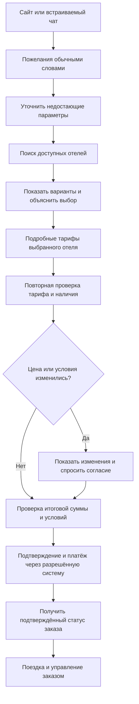

# Как встроить помощника в путь Островка

За основу взято [руководство Островок API v3](https://docs-api.ostrovok.ru/docs/integration-guide/): поиск, подробный тариф выбранного отеля, проверка тарифа, оформление и проверка статуса. Ниже — целевая схема интеграции; **текущий прототип не оформляет настоящие бронирования и не принимает платежи**.

Схема отличается от базовой интеграции тем, что перед поиском агент помогает сформулировать запрос, а между ответами сервиса и оплатой объясняет ограничения и изменения. Отказ, отсутствие тарифа, ошибки и неизвестный статус должны быть явно показаны пользователю: «не удалось подтвердить» не равно «забронировано».

## Что уже есть

- Общая логика диалога используется полным сайтом и встраиваемым чатом; параметры, которые человек не назвал, уточняются.
- Демонстрационный сценарий содержит корзину, выбор способа оплаты и отдельное подтверждение. Списания, билетов и реальной брони нет.
- Изолированный адаптер `domains/trips/providers/ostrovok.py` реализует **только поиск отелей по координатам** по [официальному B2B-контракту](https://docs-api.ostrovok.ru/docs/b2b-api/hotel-search/search-by-geo-coordinates/). Он принимает ключ партнёра извне, не пишет его и эхо запроса в результаты, не умеет вызывать бронирование. Проверен на имитации ответов; настоящего ключа и проверки с сервером нет. К интерфейсу пока не подключён.
- Справочник GeoNames помогает распознать географическое название; он не подтверждает наличие отелей, цен, рейсов или возможности поставить палатку.

## Что необходимо при настоящей интеграции

1. Согласовать доступ, условия использования, лимиты и разрешённую передачу ключа; определить B2B или Affiliate API и контракт партнёра. По официальной документации доступ предоставляется зарегистрированным партнёрам.
2. Запрашивать только нужные для поиска сведения, в том числе возраст каждого ребёнка, когда он нужен API. Не придумывать гражданство или возраст; согласовать обработку данных и политику хранения.
3. Сопоставить результаты поиска со справочником объектов и показать только достоверные атрибуты. Цена поиска предварительная, возможны дополнительные налоги и сборы; запросить подробный тариф только выбранного отеля.
4. После выбора тарифа выполнить рекомендуемую проверку доступности и цены (prebook) **до** перехода в процесс бронирования. Если цена или условия изменились, показать разницу и получить согласие пользователя.
5. Реализовать создание заказа, подтверждение, получение финального статуса и отмену строго по согласованному контракту; не повторять неизвестный исход операции вслепую и не показывать успех до подтверждённого статуса.
6. Данные карты направлять только через сертифицированный платёжный механизм провайдера; не передавать их языковой модели и не сохранять в журнале или истории чата.
7. Покрыть реальные контракты ответов, смену цены, недоступность, таймауты и неопределённый статус интеграционными тестами в разрешённой среде. Проверить юридические основания и документацию обработки персональных данных; один технический фильтр не обеспечивает соответствие 152-ФЗ.

В [документации авторизации](https://docs-api.ostrovok.ru/docs/fundamentals/authorization/) отдельно указано, что даже бронирование тестового отеля создаёт реальные финансовые обязательства. Поэтому никакие методы создания брони из прототипа не вызываются.
