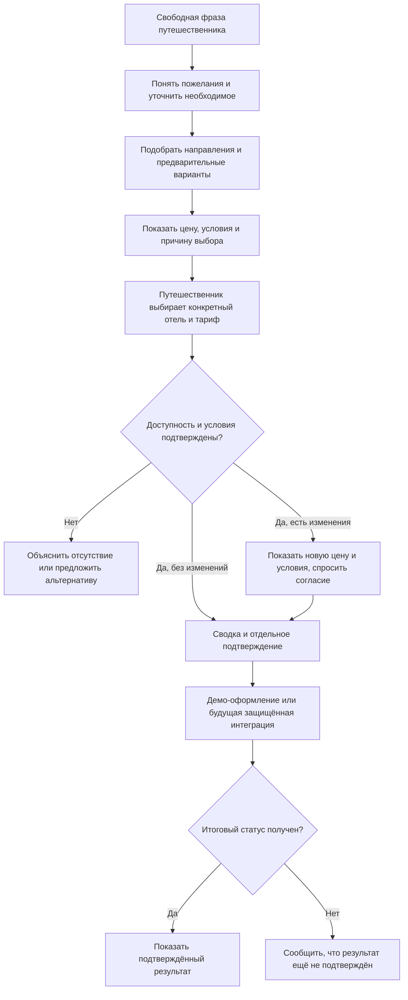

# Островок: что взять из API и B2B для нашего продукта

Сверено 27 октября 2026 года. Пользователь просит изучать эти материалы как источник хороших сценариев и идей для улучшения. **Подключение платного партнёрского API не является обязательным действием в рамках этой задачи.** Просмотрены [руководство по интеграции](https://docs-api.ostrovok.ru/docs/integration-guide/), основные разделы [лучших практик](https://docs-api.ostrovok.ru/docs/best-practices-for-apiv3/), отдельные методы поиска, предбронирования и оформления, публичная [страница B2B](https://b2b.ostrovok.ru/) и несколько материалов справки. Это не аудит каждой страницы документации и не тест личного кабинета.

Ссылка пользователя на коллекцию Postman открылась только с авторизацией; содержимое, принадлежность коллекции и настройки пока **не проверены**. Postman — инструмент для работы с API; по самой ссылке нельзя заключить, что это тестовая среда или что любые содержащиеся запросы безопасны. Не публиковать токены, историю запросов, переменные окружения или содержимое приватной коллекции без проверки.

## Как устроен официальный путь

Островок описывает последовательность: поиск по региону/координатам/объектам → выбор отеля → подробные тарифы → проверка выбранного тарифа (Prebook) → заполнение формы → запуск оформления → получение итогового статуса. Есть и альтернативный путь с Prebook после поиска. Адаптированная схема для нашего продукта:

На хакатоне состояние, цены и оформление в этом пути — **демонстрация**, если данные получены из нашего каталога. Схема показывает направление для интеграции, а не уже работающую связь с Островком. Сейчас есть только отдельный адаптер поиска по координатам, проверенный на имитациях и не подключённый к интерфейсу; реальных ключей и проверок API у команды не подтверждено.

## Идеи для диалога и интерфейса

| Идея | Что взять из источника | Что сделать в нашем прототипе | Статус |
|---|---|---|---|
| От идеи к конкретному тарифу | На этапе общего поиска показывают ориентиры, а подробные тарифы — после выбора отеля. [Руководство](https://docs-api.ostrovok.ru/docs/integration-guide/). | Не требовать все сведения до вдохновения; когда пользователь выбирает объект — объяснять различия конкретных вариантов. | Частично: есть идеи и варианты, подробность и последовательность проверить. |
| Нужные вопросы по ситуации | Для реального поиска нужны даты, состав и, при детях, возраст каждого ребёнка; для некоторых тарифов важна страна паспорта (`residency`). [Практики](https://docs-api.ostrovok.ru/docs/best-practices-for-apiv3/). | Не спрашивать возраст заранее, если можно просто вдохновить. Спросить перед действием, где данные действительно нужны; страну паспорта не выводить из IP и не путать со страной отдыха. Наш демо-подбор пока не требует реальный API. | Частично: состав уточняется; возраст детей и `residency` для будущего провайдера не выдумывать. |
| Изменение тарифа | Prebook может вернуть другую цену и даже иные условия, включая отмену; изменение цены нужно показать. [Описание Prebook](https://docs-api.ostrovok.ru/docs/b2b-api/hotel-search/prebook-rate-from-hotelpage-step/). | Демо может воспроизвести состояние «цена/условия изменились» с прежними и новыми условиями и отдельным согласием. **Это предложение к реализации**, сейчас его наличие не доказано. | Открыто. |
| Доступность и статус | До подтверждения статус может быть неопределённым; успешный заказ требует результата проверки или webhook. [Статус брони](https://docs-api.ostrovok.ru/docs/best-practices-for-apiv3/). | Не писать «забронировано» при сбое или таймауте; ясно обозначать демо. Для реальной интеграции не повторять опасные действия вслепую. | Частично: демо-оформление есть; реальные статусы не подключены. |
| Цена и сборы | API отдельно возвращает налоги и сборы, в том числе не включённые поставщиком. [Практики](https://docs-api.ostrovok.ru/docs/best-practices-for-apiv3/). | Показывать состав цены и неизвестные доплаты; не обещать итог, если часть расходов неизвестна. | Открыто для независимой проверки интерфейса. |
| Правила отмены | В ответах могут быть периоды бесплатной/штрафной отмены; время API указывается в UTC. [Практики](https://docs-api.ostrovok.ru/docs/best-practices-for-apiv3/). | Показать понятный срок и условия рядом с ценой, не придумывая их; при реальном подключении корректно отображать часовой пояс. | Частично: условия в демо синтетические. |
| Подборка конкретных тарифов | В B2B подборку можно составлять не только из отелей, но и из подходящих конкретных тарифов. [Справка B2B](https://help.b2b.ostrovok.ru/ru/articles/7848158). | При сравнении показывать, какой именно тариф выбран: питание, отмена, тип номера, итог и компромиссы. | Частично: карточки и корзина есть, уточнить детали. |
| Карта и фильтры | Публичная страница B2B описывает карту и более 20 фильтров. [B2B](https://b2b.ostrovok.ru/). | Совместить свободный запрос с наглядной картой и возможностью поправить существенное; не заставлять пользователя вручную заполнять длинную анкету. | Частично: карта и выбор места есть. |
| Работа после покупки | Документация содержит получение заказа и отмену. [Руководство](https://docs-api.ostrovok.ru/docs/integration-guide/). | В демо сохранить явное подтверждение отмены/изменений; настоящее управление заказом пока не заявлять. | Частично. |

Возраст ребёнка, гражданство и платёжные сведения могут иметь значение для реального бронирования, но не все данные нужны на этапе знакомства. Не просить реальные паспортные данные и карты в чате демо; интеграция с защищённой формой и правовое основание обработки требуют отдельной проработки.

## Чего не перепутать с нашим проектом

- Наши названия и координаты многих гостиниц взяты из Overture Maps; цены, наличие, рейтинги, отзывы, удобства, маршруты, оплата и заказ в текущем демо — модельные. Географический справочник не является каталогом реальных доступных тарифов.
- Историческая погода в демо не является прогнозом. Настоящие доступность, цена, налоги, правила отмены и визы нуждаются в актуальном разрешённом источнике.
- Для настоящего доступа к Островок API нужны зарегистрированный партнёр, подходящий ключ и соблюдение условий; переход в production связан с сертификацией. [Авторизация](https://docs-api.ostrovok.ru/docs/fundamentals/authorization/), [сертификация](https://docs-api.ostrovok.ru/docs/certification/).
- **Не выполнять тестовые бронирования:** [страница авторизации](https://docs-api.ostrovok.ru/docs/fundamentals/authorization/) предупреждает о финансовых обязательствах даже для тестового отеля, а [лучшие практики](https://docs-api.ostrovok.ru/docs/best-practices-for-apiv3/) иначе описывают тестовую и боевую среды. До письменного уточнения у поставщика использовать только локальные фикстуры и имитации. Запросы Postman на создание/отмену/оплату не запускались.
- Сами идеи пользовательского пути можно реализовывать независимо, но чужой код, фотографии, тексты и данные использовать только по подходящей лицензии и с соблюдением условий источника.

## Проверки, предложенные по документации

Все числа и тарифы в примерах вымышлены. Эти проверки пока **PLAN**, если в [реестре тестов](10_Реестр_проверок.md) прямо не записан другой результат:

1. Пользователь не знает даты: предложить идеи без выдуманной цены; когда хочет рассчитать — уточнить недостающее.
2. Два взрослых и ребёнок: не угадывать возраст; если выбран реальный поиск, объяснить зачем нужен возраст и что без него цена неизвестна.
3. Цена условного тарифа изменилась с 50 000 до 55 000 ₽: показать обе суммы, не подтверждать заказ без согласия.
4. Цена не изменилась, но бесплатная отмена исчезла: показать изменение, не подменять выбор пользователя.
5. Тариф недоступен: сообщить это и дать выбор альтернативы, не обещая брони.
6. Оформление зависло или вернуло неопределённый статус: показать ожидание/неподтверждённый результат, не создавать второе оформление автоматически.
7. Показать сравнение двух конкретных тарифов с питанием, отменой и сборами; отсутствие данных обозначать как неизвестность.
8. Пользователь нажимает место на карте: оно передаётся в диалог как выбор пользователя, а не как доказательство доступности и цены.
