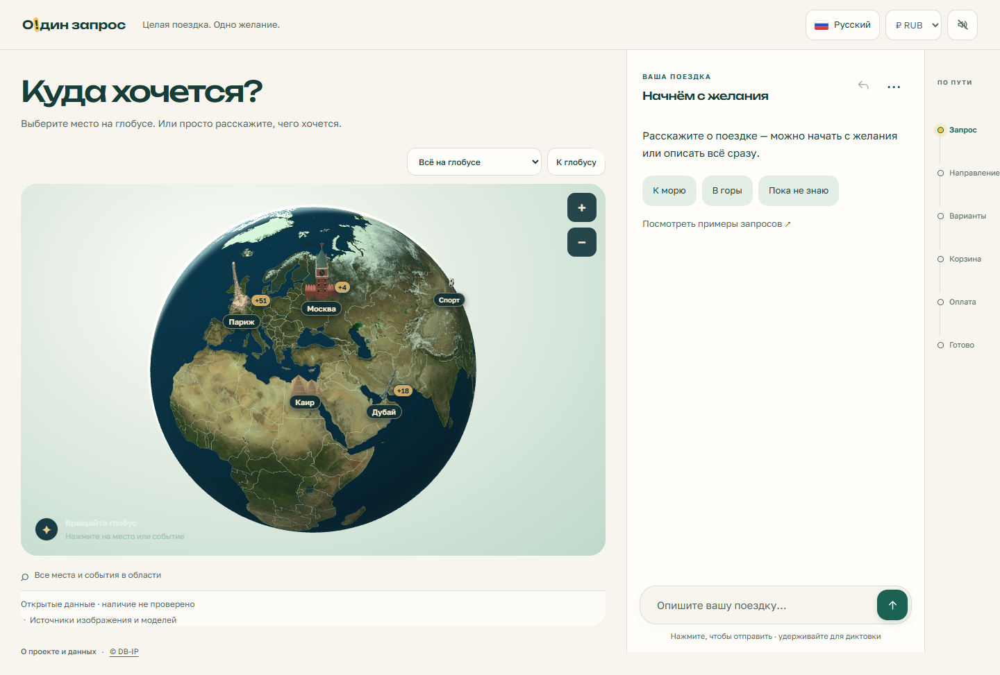

# Единый сайт «О!дин запрос» — 28 октября 2026

Собраны в одну реализацию маскирование персональных данных, новый чат, диктовка, темы, 3D-глобус, выбор объектов карты, улучшения дат и диалога. Репозиторий `ostrovok-hackathon-2026/iskusstvennyi-praim` остаётся закрытым.

Проверенный функциональный коммит: `fe76222`; окончательная правка читаемости подсказки глобуса: `2d3891f45d86360b9c3bcb31855d2bfabac7e9df`. Последующий коммит содержит документацию и обезличенные результаты. Полные SHA исходных веток — в [реестре](evidence/unified_20261028/branches.json).

## Ветки и сохранение работ

- `main` — единый сайт, общая точка сборки.
- `artemiy` — рабочая ветка Артемия.
- `daniil` — рабочая ветка Даниила.

На момент объединения все три начинают с одного результата. Исходные девять удалённых веток и локальный глобус входят в историю объединения. Их прежние вершины сохраняются отдельными метками `archive/2026-10-28/*`; лишние удалённые ветки сокращаются только после проверки опубликованных меток и общей версии. Локальные рабочие копии других чатов не удаляются и не меняются.

Включены `dfd9ef1` (защита данных), `6dc1f07` и более свежий `b0c275e` (интерфейс, чат, темы), `fec4e5b` (глобус), `cd7eb77` (даты, сложные запросы, выбор настоящих записей отелей), а также их предшественники, включая `c91abb1`, `0fb65da`, `46da450`, `c585ca1`, `807cdfe` и прежний `main`. Глобус ранее не был опубликован, теперь его код, изображения, модели и лицензии входят в общий сайт.

Проверены дополнительные локальные копии проекта. В отдельном старом стенде оказались незакоммиченные копии пяти наборов проверок, уже совпадающих с включёнными после нормализации переводов строк, и двух старых сценариев, заменённых расширенными версиями в `eval/`. Их повторное копирование не требуется. Локальная `.superdesign` — вспомогательное состояние инструмента, не часть работающего сайта; её не включали. Другой репозиторий команды с ассистентом поликлиники к этому сайту не относится и не объединялся.

## Что согласовано между частями

- Выбор отеля с глобуса передаёт точный идентификатор, координаты и запись источника. Сводка, состояние диалога и демонстрационный расчёт используют один объект. Выбор другой записи в том же городе теперь применяется даже без новых текстовых параметров.
- Редактирование последней реплики и отмена шага восстанавливают серверное состояние. Выбор на карте во время редактирования добавляет самостоятельный шаг. Отмена не откатывает оформление заказа.
- Выбор города/страны и прерывание уточнений сохраняют условия поездки. Включены исправления относительных дат, полных и неточных запросов, выбора отеля по имени/номеру и предположительного города отправления по IP.
- Маскирование текста применяется и при редактировании. Если локальная проверка не работает или остались признаки чувствительных сведений, внешний вызов не используется. Эвристика не гарантирует обнаружение всех персональных данных.
- Сохранены шесть вариантов оформления, удержание для диктовки, мобильное переключение карта/чат, виджет, 110 событий, 108 объектов ЮНЕСКО и основной набор достопримечательностей. Источники и лицензии 3D-моделей доступны под глобусом.
- Исправлены пересечения разметки, восстановления загрузки, истории сообщений и CSS. Подсказки глобуса используют читаемые цвета общей темы.

«Дообучение» по уточнению владельца означает улучшения диалога из веток. Новые веса LLM не обучались. Работают GigaChat-2-Max для разбора пожеланий, локальная GigaAM для речи, правила и проверка ответов модели.

## Проверки

Машиночитаемый полный перечень, включая первоначальные неудачи: [checks.json](evidence/unified_20261028/checks.json).

| Проверка | Результат |
|---|---|
| Полный `python -m pytest -q --tb=short` | **571 passed**, 155,92 с, Python 3.14.6, без внешней модели. Первый объединённый вариант до дополнительных тестов: 567 passed. |
| Новые стыки веток | **4/4**: смена источникового отеля через карту и отмена, сохранение точного ID в расчётах, отмена города/редактирование, маскирование при редактировании. |
| Интерфейс | **39** проверок: редактирование, отмена, условия, сброс, темы, мобильная карта, reduced motion и имитация голоса. |
| Граничные случаи диктовки | **6** проверок: лимит 20 секунд, отпускание после остановки, один клик — одна отправка, отмена указателем. Микрофон имитировался. |
| Общий интерфейс и сервер | **13** проверок: карта → точный отель → сводка → отмена, выбор во время редактирования, виджет, источники, размеры 1440×940, 390×844, 320×700 и 844×390. |
| Глобус | Вращение и Париж, Мексика/Формула-1, Россия, четыре категории событий, совпадение события с достопримечательностью, группировка, карточка в пределах карты. Размер Эйфелевой башни при приближении: 47/46/45 px. |
| Отказы ресурсов | Земля и модели работают локально при блокировке внешних ресурсов; при искусственном отказе изображения и моделей выбор места сохраняется. В тесте IPinfo отдельно имитирован. Восстановление стартовой загрузки и самостоятельная карта прошли. |
| Контраст кнопки отправки | 7,19:1 в основном интерфейсе при светлом/тёмном предпочтении ОС; 6,95:1 в виджете. Основной интерфейс использует собственные светлые темы. |
| Живая GigaChat-2-Max | **4/4** реплики с `llm+rules`: Казань, вопрос об отмене, семь дней, смена на Дубай с сохранением длительности. Вымышленные вводные, существующий личный доступ, ключ не экспортируется. |
| Локальная GigaAM | **PASS**: синтезированная Windows русская фраза «Хочу поехать в Казань из Москвы на семь дней» распознана с сохранением города, отправления и длительности; число нормализовано в `7`. Реальный микрофон не проверялся. |
| Статика и публикация | Синтаксис JS/модулей и Python, `git diff --check`, проверка включения всех исходных вершин, поиск сигнатур секретов. |

Повторение: установить зависимости в отдельном окружении из `requirements-dev.txt`; `python -m tools.build_map_catalog`; `ODIN_MODE=rules python -m pytest -q`. Для Windows задайте `$env:ODIN_MODE='rules'`. Для браузерных проверок открыть локальный сайт через `playwright-cli`, затем выполнять `run-code --filename tools/verify_interface.js` и остальные сценарии из `checks.json`. Для живых моделей использовать собственные разрешённые настройки по README. Голосовая проверка на Windows: `powershell -File eval/asr_synthetic_windows_20261028.ps1 -Url http://127.0.0.1:8080`.

## Первоначальные проблемы и пределы доказательств

В первом браузерном проходе после слияния сломалось редактирование реплики: логическое выражение возвращало флаг вместо объекта последнего шага. Исправлено, повтор прошёл. Дополнительный тест выявил игнорирование повторного выбора отеля в том же городе и несогласованную запись источника; оба исправления проверены общим набором и браузером.

Старый сценарий загрузки глобуса ожидал модели на скрытой мобильной карте и завершился по таймауту; сценарий теперь открывает карту. Попытка получить публичную аудиозапись завершилась сетевым сбросом WinError 10054 ещё до распознавания. Вместо неё проверена собственная синтетическая фраза. Начальная проверка ожидала слово «семь», а модель выдала `7`; затем исправлена также обработка UTF-8 JSON в Windows PowerShell. Эти неудачи сохранены в реестре, не выданы за успешные проверки.

Свежая сборка Docker с Python 3.12 не выполнялась: использованы уже установленные зависимости, модель речи и один заново построенный индекс карты. Реальные телефоны, микрофон и внешний хостинг не проверялись. Браузерные размеры — эмуляция на компьютере. Проверки ограничены подготовленными сценариями, не являются независимым исследованием качества модели.

Цены, транспорт, доступность, оплата и бронирование остаются демонстрационными. Настоящие покупки не совершались. Данные карты, событий, климата и фото имеют прежние ограничения и даты снимков. Ключи, аудиозаписи, веса моделей, персональные настройки, собранный индекс и сырые журналы инструментов не входят в публикацию.

## Просмотр

[Мобильный чат](evidence/unified_20261028/site-mobile-chat.png) · [Мобильный глобус](evidence/unified_20261028/site-mobile-globe.png)
