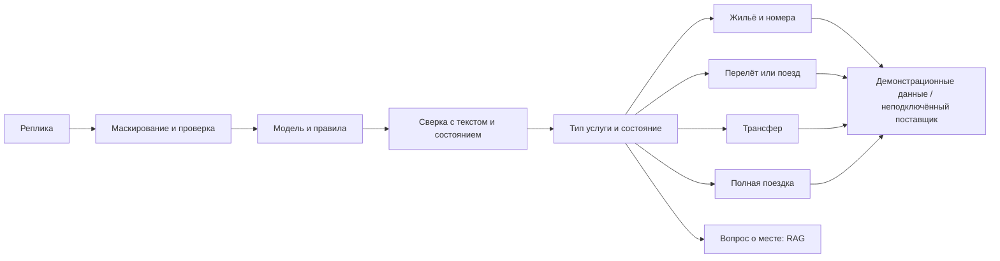

# Диалог, услуги и подтверждение условий

Рабочая база — `b1d6656cf18f598777f97ed40f1f45dc950cbedb`, исходный коммит друга `92efb09d6bf3e47be0b9b918e867a5f3596ed6c7`. Проверка актуальных удалённых веток и окончательный результат — в отчёте этой задачи. Существующий сайт и модуль приватности сохранены.

## Проектное решение

Один диалог принимает свободный текст. Не нужно заставлять путешественника до начала беседы выбирать услугу: явное «только жильё», «нужен трансфер», «только перелёт» или «два отеля» выбирает соответствующий сценарий, а полная поездка продолжает объединять дорогу, жильё и трансфер. При двух отелях диалог различает сравнение на одни даты и проживание по очереди. Уточнения появляются, когда они нужны конкретной услуге. Кнопки — помощь, а не обязательный первый шаг.

Языковая модель помогает с пониманием и некоторыми ответами о месте; даты, распределение гостей, подтверждения и тарифы не должны приниматься лишь потому, что модель их назвала. Для некоторых структурированных ответов на ожидаемый вопрос данные обрабатываются правилами без повторной передачи модели. Общий свободный текст и данные состояния по-прежнему могут передаваться облачному поставщику после эвристического маскирования; полное обезличивание не гарантируется.

## Покрытие пользовательских пожеланий

| Возможность | Что работает в прототипе | Чего нет |
|---|---|---|
| Жильё отдельно | Поиск демонстрационного жилья без города отправления и дороги; сохранение бюджета, еды, отмены и других имеющихся фильтров | Подтверждённых тарифов, наличия и реального оформления нет |
| Два и более номера | Явное распределение гостей по пронумерованным номерам; расчёт демо-цены каждого номера и сложение; возраст ребёнка нужен для распределения | Наличие нескольких номеров и реальные детские тарифы не подтверждены; синтаксис распределения ограничен |
| Два отеля | Сравнение на одни даты или две последовательные демонстрационные остановки с разными отелями, выбор показанной пары и проверка её неизменности | Для двух остановок одновременно поддерживается один номер; переезд, реальная доступность и бронирование не рассчитаны |
| Трансфер отдельно | Город, категории аэропорт/вокзал/отель, направление, дата, время, число пассажиров; примеры классов автомобиля | Конкретный адрес, актуальный парк, цена, детские кресла и реальная заявка не подключены; обратное время нужно отдельно уточнить |
| Самолёт/поезд и класс | Эконом, бизнес, первый, купе, плацкарт, сидячий распознаются как явное требование; выдача не заменяет отсутствующий класс другим | Синтетический каталог содержит только часть классов; реальные места, тарифы и условия не проверяются |
| Детский тариф | Контракт различает бесплатный, льготный, полный и неизвестный тариф с ценой, валютой, источником и признаком места; вопрос о льготе не добавляет ребёнка в поездку | Реальный поставщик детских авиа- или ЖД-тарифов не подключён. Демонстрационная поездка считает дорогу одинаково на человека и прямо об этом сообщает |
| Относительные даты | «Завтра», «послезавтра», «следующий месяц», переход года, некоторые опечатки и явное отрицание «не завтра» | Нельзя гарантировать все формулировки; время и часовой пояс поставщика отдельно не подтверждены |
| Температура воздуха и моря | Явные пороги сравниваются с историческими средними по известному месяцу | Это не прогноз, не гарантия купания и не температура рек или озёр |
| Разные формулировки и RAG | Добавлены отдельные разговорные, ошибочные и английские вопросы о еде, местах, покупках и транспорте; используется гибридный поиск по собственным снимкам | Охват слов и языков не измерен на реальных пользователях, модель и поиск могут ошибаться; RAG не является базой актуальных билетов или цен |

## Что взято из документации Островка

[Руководство интеграции](https://docs-api.ostrovok.ru/docs/integration-guide/) различает первичный поиск, страницу конкретного отеля и проверку тарифа перед бронированием. Начальная цена не должна считаться окончательной. В [лучших практиках](https://docs-api.ostrovok.ru/docs/best-practices-for-apiv3/) и [методе поиска](https://docs-api.ostrovok.ru/docs/b2b-api/hotel-search/search-by-geo-coordinates/) состав задаётся отдельно для каждого номера: взрослые и список возрастов детей. В документации для данного API указаны до 9 номеров, до 6 взрослых и 4 детей в номере.

В коде эти ограничения проверяются до сетевого вызова; адаптер формирует `guests` по номерам и помечает цену этапа поиска как предварительную. Проверка проводилась с подменённым ответом HTTP. Это не подключение настоящего партнёрского API, не подтверждённая бронь и не реализация hotelpage/prebook. Документация размещения не задаёт универсальных бесплатных авиа- или железнодорожных тарифов для детей.

## Сравнение датасетов веток

Сверены деревья `origin/artemiy` `5d1a32d645c5eb8920c48d0064f99f7fbb63b8be` и исходного `92efb09`. Пользовательские снимки отелей, климата, городов, аэропортов и других геоданных уже присутствуют в версии друга теми же Git-объектами. Друг добавил путеводители и их векторы; `geo.json` расширен с 7 до 290 городов отправления при тех же 75 направлениях. Повторное физическое объединение идентичных снимков создало бы дубли; дополнительные непроверенные датасеты не подмешивались. Источник и атрибуция данных сохраняются.

## Пределы безопасности и дальнейшее развитие

Следующий шаг для реальных предложений — подключить разрешённые источники отдельных услуг, хранить идентификатор, валюту, состав, время и срок действия каждого тарифа, повторно проверять конкретный вариант перед действием и не приравнивать неизвестное условие к выполненному. Для детских билетов нужны правила и цены конкретного перевозчика на даты поездки; нельзя вывести бесплатное место или скидку из одного возраста. Нужны независимая оценка на обезличенных естественных запросах, тесты на противоречия, пропуски, смешение услуг, сложные языковые случаи и отказ поставщика. Сам набор правил и тестов не обеспечивает нулевую частоту ошибок и не гарантирует балл жюри.
